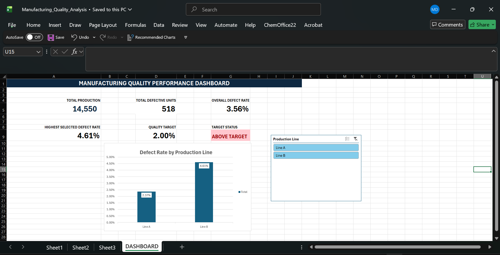

# Manufacturing Quality Performance Dashboard | Excel
An interactive Excel business-intelligence practice project analyzing production output and defects across two manufacturing lines. The dashboard turns production records into quality KPIs, highlights lines that need attention, and compares results with a management target.
> **Data disclosure:** This workbook contains a small **practice/demo manufacturing dataset**, not verified operational records from a real employer. The **2% defect-rate target is hypothetical**, selected to demonstrate threshold-based reporting.
## Dashboard Preview

## Business Questions
How many units did each line produce?
What proportion of each line's units were defective?
Which production line should quality management investigate first?
How do results compare with a hypothetical 2% defect-rate target?
## Dataset
Period represented: October 1–5, 2026
Observations: 10 daily production-line records (5 per line)
Fields: Date, Production Line, Units Produced, Defective Units
Derived metric: Defect rate = Defective Units / Units Produced
## Key Findings

| Measure | Line A | Line B | Overall |
|---------|--------|--------|---------|
| Units Produced | 6,800 | 7,750 | 14,550 |
| Defective Units | 161 | 357 | 518 |
| Defect Rate | 2.37% | 4.61% | 3.56% |
**Key Insight:** Line B's defect rate is approximately 1.95 times that of Line A, making it the first candidate for a root-cause investigation.

These findings describe the practice dataset only and do not establish the cause of defects.
## Methods and Excel Features
`SUM`, `SUMIF`, and percentage formulas for quality metrics
PivotTables to summarize results by production line
A PivotTable calculated field for defect rate
A PivotChart for comparing production-line defect percentages
A slicer connected to two PivotTables and the PivotChart
Dynamic dashboard KPIs using `GETPIVOTDATA`, `IFERROR`, `MAX`, and `IF`
Red/green conditional formatting for target status
## How to Explore the Workbook
1. Open `Manufacturing_Quality_Analysis.xlsx` in Microsoft Excel.
2. Open the DASHBOARD sheet.
3. Use the Production Line slicer to view Line A, Line B, or both.
4. Observe how the production, defect count, defect rate, and target-status KPIs change.
5. Use the slicer's Clear Filter button to return to the full dataset.
6. Inspect Sheet1 for the underlying data and Sheet3 for the PivotTables.
## Quality-management recommendations
Prioritize Line B for investigation because its observed defect proportion is higher.
Break defects down further by type, shift, equipment, and operator before assigning causes.
Track defect rates over time with a consistent denominator and a documented target.
Validate the data and the calculation logic before decisions are made from actual operations.
## Known Limits and Next Steps
The dataset is only 10 observations; more records are needed for robust operational conclusions.
The source range and some formulas refer to fixed cells, so expanding the dataset will require updating the source range / formulas and refreshing the PivotTables.
The highest-selected-rate KPI is tailored to the current two-line PivotTable layout; it should be redesigned before adding more lines.
Recommended next additions: trend chart, defect-category Pareto analysis, and a dynamic label naming the worst-performing line.
## Portfolio Context
This practice project combines Excel analytics with an understanding of quality-control processes and demonstrates an end-to-end workflow: clean summary tables → PivotTables → interactive visualizations → actionable recommendations.
